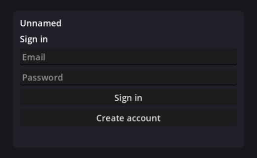

# Lesson 1: The login screen, and how this game builds its screens

For someone past the Godot basics (nodes, scenes, signals, the Inspector). This lesson is about two things:
**how this game's screens are put together**, and the **intermediate Godot techniques** the code uses to do it. Every file, node and code
snippet below is from this repo. The exercises were run for real before they were written down.



## 1. Where the login lives

```
ClientMain  (client_main.tscn)         owns the battle UI and the connection to the battle server
└─ AccountFlow  (account_flow.tscn)    the COORDINATOR: session, API calls, which screen is showing
   ├─ OverworldScreen        overworld_screen.tscn      the game view, full screen: the map, a dock and windows
   │                         (its Character window holds character_screen.tscn; rows: ui/join_request_row.tscn)
   └─ MenuPanel              the centred panel for everything outside the game view
      └─ Layout (VBoxContainer)
         ├─ TitleLabel
         ├─ SignInScreen        sign_in_screen.tscn        ← the login
         ├─ WorldPickerScreen   world_picker_screen.tscn
         ├─ JoinScreen          join_screen.tscn
         ├─ CharacterCreator    character_creator.tscn
         ├─ WorldManagementScreen  world_management_screen.tscn  (rows: ui/join_request_row.tscn)
         ├─ SettingsScreen      settings_screen.tscn
         ├─ LobbyScreen         lobby_screen.tscn          waiting on the battle server
         └─ StatusLabel         the message line (over the map, it is shown as a bar instead)
```

Each screen is its own scene and script in `game/client/screens/`. `account_flow.tscn` only *instances* them and shows exactly one at a time.
To edit the login screen open `sign_in_screen.tscn`. To change how it is wired into the flow open `account_flow.gd`.

## 2. The core pattern: signals up, calls down

This is the most useful idea in the whole client. Read it twice.

- A **screen** knows nothing about the network, the session or the other screens. It shows what it is told and **announces what the player did**
  with signals.
- The **coordinator** (`AccountFlow`) listens to those signals, does the real work (calls the API, switches screens) and **calls methods on
  the screens** to tell them what to show.

```
 SignInScreen ──signal: sign_in_pressed(email, password)──▶ AccountFlow ──▶ Supabase / API
 SignInScreen ◀──call: clear_password(), prefill_email()──── AccountFlow
```

The screen (`sign_in_screen.gd`), shortened:

```gdscript
signal sign_in_pressed(email: String, password: String)

func _ready() -> void:
	%SignInButton.pressed.connect(func() -> void: sign_in_pressed.emit(_email.text.strip_edges(), _password.text))

func clear_password() -> void:        # a "call down": the coordinator tells it what to do
	_password.text = ""
```

The coordinator wires it in `account_flow.gd`:

```gdscript
_sign_in.sign_in_pressed.connect(_on_sign_in_requested.bind(false))   # bind(false): extra argument "create = false"

func _on_sign_in_requested(email: String, password: String, create: bool) -> void:
	status.text = "Working…"
	var err: String = await sign_in(email, password)                  # talks to Supabase
	...
	if err == "": _step_worlds()                                      # route to the next screen
	else: status.text = err
```

Why this is worth the trouble:
- **Each screen is testable and editable alone.** Press F6 on `sign_in_screen.tscn` and it runs without a server. The tests in
  `tests/unit/test_ui_scenes.gd` instantiate each screen by itself, press its buttons and check the signals.
- **Screens are swappable.** A fancy character creator only has to keep emitting `create_requested(name, class_id)`.
- **No tangled dependencies:** screens never reference each other. When something goes wrong you look in exactly one place.

Rule of thumb for new code: *if it needs the network, the session or another screen, it belongs in the coordinator; if it is about showing a
form and reporting input, it belongs in the screen.*

## 3. The coordinator, in detail

`account_flow.gd` has four jobs. Find each one:

| Job | Where | Notes |
|---|---|---|
| Show exactly one screen | `_show(screen)` and the `_screens` array | Loops the array and sets `visible`. Adding a screen means adding it to `_screens`. |
| Talk to the API / Supabase | `_request()`, `api()`, `_auth_call()` | One `HTTPRequest` per call, `await`ed. Returns `{status, data, error}` so callers never touch raw responses. |
| Keep the session | `sign_in()`, `_adopt_session()`, `_refresh()` | Details below. |
| Decide where to go next | `_step_worlds()`, `_step_world()`, `_enter_game()`, ... | The routing. Reads like a story: sign in → picker → membership check → the map (or the join screen) → battle. |

It exposes only a small surface to `ClientMain`: the signals `entered(server, token, name, world, party)`, `backed_out`, `token_refreshed`, and the methods `show_lobby()` and
`return_to_menu()`. Everything else is internal.

## 4. How sign-in works in this game

- **Supabase password grant.** `sign_in()` POSTs email and password to `/auth/v1/token?grant_type=password` with the public publishable key.
  The response holds an **access token** (a signed JWT, valid about an hour) and a **refresh token**.
- **The password is never stored.** Only the refresh token is kept, in `user://account.cfg` (on the web, browser storage), so the next launch
  signs in silently via `_restore_session()`.
- **Silent renewal.** `_adopt_session()` starts `RefreshTimer` for `expires_in - 120` seconds. When it fires `_refresh()` swaps in a new
  token and emits `token_refreshed`, and `ClientMain` hands the new token to the network client, so a long battle never outlives its login.
- **The token is the identity.** It goes to the API as `Authorization: Bearer ...`, and to the battle server in the first message
  (`c_hello`). The server never trusts a user id from the client: it asks the API to verify the token and returns the user. That is why there is no
  "player id" field anywhere in the client.
- **Email confirmation** is a Supabase setting. With it on, `sign_up()` returns "Check your email..." instead of a session.
- **Web builds** use `"same-origin"` for the API and server addresses in `client_env.json`; `_api_base()` and `_server_url()` resolve them from the
  page's own address (`JavaScriptBridge`), so the same build works on localhost and on a real domain.
- **A test hook:** `ClientMain` publishes the current screen (`menu`, `lobby`, `battle`, `result`) as `window.unnamedState`. The browser tests in
  `tests/browser/` wait on it instead of guessing with timers.

## 5. Godot techniques this code leans on

**`%UniqueName` only works inside one scene.** This is the classic trap with composed scenes. `%EmailEdit` is found from any script
*inside* `sign_in_screen.tscn`, but the coordinator cannot reach it with `%EmailEdit`, because that node lives inside an instanced scene. From outside
you go through the instance: `get_node("%SignInScreen").get_node("%EmailEdit")`, or better, add a method to the screen so outsiders never need to. In
`account_flow.gd`, `%SignInScreen` works because the screen's *root* is marked unique in `account_flow.tscn`. (A unit test in this repo failed on exactly this.)

**Ready order.** A child's `_ready()` runs before its parent's. That is why `@onready var _sign_in: SignInScreen = %SignInScreen` is valid in
`AccountFlow` and the coordinator can connect to the screens' signals in its own `_ready()`. The flip side: calling a method that uses `@onready`
variables *before* the node is ready crashes with "on a base object of type 'Nil'". `setup()` guards against this with
`if not is_node_ready(): await ready`.

**`class_name` as a typed handle.** `SignInScreen`, `CharacterCreator` and friends are global types. Typing the variable
(`var _sign_in: SignInScreen`) gives you autocomplete, catches typos at parse time, and lets you call the screen's methods directly.

**`@export var row_scene: PackedScene`.** `WorldManagementScreen` (and `OverworldScreen`) do not hardcode which scene makes a row; you drag one into the Inspector. Code
instances it with `row_scene.instantiate() as JoinRequestRow`. Use this whenever a script creates many copies of something a designer might restyle.

**Instance overrides.** In `account_flow.tscn` each `[node name="SignInScreen" parent="Layout" instance=...]` also carries `layout_mode` and
`unique_name_in_owner`. Those are *overrides on the instance*, saved in the parent scene. They never change the screen's own file. Right-click an
instance and choose **Editable Children** to see and override its inner nodes (use sparingly: it couples the parent scene to the child's internals).

**Coroutines for UI.** `var r := await api(...)` suspends that function until the HTTP call finishes while the game keeps running. Two rules:
(1) anything that `await`s is a coroutine, so callers that do not `await` it simply continue immediately; (2) after an `await` the world may have
changed (the screen was hidden, the node freed). That is why `_check_membership()` starts with `if ... or not _join.is_visible_in_tree(): return`.

**Timers as nodes.** `JoinScreen` has a `PollTimer` child (4 s). While a join request is pending the timer asks the coordinator to re-check, so the
page advances by itself once the host approves. The screen stops the timer in `visibility_changed`, so it never polls for a screen nobody sees.
Timer nodes are easier to see and tweak in the editor than `get_tree().create_timer()` calls buried in code.

**Lambdas and `bind()`.** `func() -> void: ...` creates an inline handler; variables it uses are *captured by value* when it is created (see how
`WorldManagementScreen` creates one pair of handlers per row). `.bind(false)` appends an argument to a callable. Use `bind` for "same handler,
different constant", a lambda for a one-off.

**Themes cross instance boundaries.** The theme is set once on `ClientMain`. Every screen inside inherits it, wherever it is instanced. Per-node
*Theme Overrides* beat the theme for that node only.

## 6. Exercises

Save with Ctrl+S. If anything breaks, Ctrl+Z, or check the **Debugger** panel.

### Exercise A: a "Show password" tick box (inside one screen)
1. Open `sign_in_screen.tscn`. Right-click the root → **Add Child Node** → `CheckBox`. Rename it `ShowPasswordCheck`, set **Text** to `Show password`,
   right-click it → **Access as Unique Name**, and drag it between `PasswordEdit` and `SignInButton`.
2. Open `sign_in_screen.gd` (the scroll icon next to the root). At the end of `_ready()` add:
   ```gdscript
   %ShowPasswordCheck.toggled.connect(func(on: bool) -> void: _password.secret = not on)
   ```
3. F6 to try it. Notice you touched *only* the screen: the coordinator, the flow and the tests are unaffected. That is the payoff of section 2.

### Exercise B: add a whole new screen to the flow
A "tip" screen shown once after sign-in and before the world picker. This is the workflow for any new screen.

1. **Script.** Create `game/client/screens/tips_screen.gd`:
   ```gdscript
   class_name TipsScreen
   extends VBoxContainer
   ## A short tip shown once after sign-in.

   signal continue_pressed

   func _ready() -> void:
   	%ContinueButton.pressed.connect(func() -> void: continue_pressed.emit())
   ```
2. **Scene.** FileSystem → right-click `screens` → **New Scene**: root node type `VBoxContainer`, rename it `TipsScreen`. Attach `tips_screen.gd`
   (select the root, click the **attach script** icon, choose the existing file). Add a `Label` child with your tip text (set
   **Autowrap Mode** to *Word (Smart)*) and a `Button` child named `ContinueButton` with **Access as Unique Name** ticked. Save as `tips_screen.tscn`.
3. **Instance it.** Open `account_flow.tscn`. Drag `tips_screen.tscn` from the FileSystem onto the `Layout` node, drop it above `StatusLabel`.
   Select the new node, rename it `TipsScreen`, and tick **Access as Unique Name**.
4. **Register and route it** in `account_flow.gd`:
   - add `@onready var _tips: TipsScreen = %TipsScreen` next to the other screens;
   - add `_tips` to the `_screens` array;
   - in `_ready()` add `_tips.continue_pressed.connect(_step_worlds)`;
   - in `_on_sign_in_requested`, in the success branch, replace `_step_worlds()` with `_show(_tips)`.
5. **Run it.** After a successful sign-in you see the tip, and Continue goes on to the world picker.

   I applied exactly these steps to the real code to check them: 8 screens registered, only the tip visible when shown, the signal fires,
   and the sign-in success path routes to it. Then I reverted it, so the repo does not contain a tip screen.
6. **Test it** (good habit): copy the pattern in `tests/unit/test_ui_scenes.gd` (`_screen(path)`, `_press(node, "ButtonName")`, connect to the
   signal, assert).

### Exercise C: read before you change
Open `character_creator.gd` and `account_flow.gd` side by side. Trace what happens from the moment you press **Create** in the creator to
the moment the map opens with the new character in its corner. You should cross: the signal `create_requested` → `_on_create_character_requested`
→ `api(POST /characters)` → `_enter_game()` → `OverworldScreen.set_header()`. That is the whole pattern in one path.

## 7. Where an elaborate character creator would go

`character_creator.tscn` is deliberately its own scene. To grow it:
- Keep its contract: emit `create_requested(character_name, class_id)` (add parameters when you add choices) and `back_pressed`.
- Build it from sub-scenes: for example a live preview using a `SubViewportContainer` around a `SubViewport` that contains a unit scene from
  `game/content/units/`, plus tabs for class and appearance. Option lists make good resources (`@export var options: Array[...]`).
- Anything the character should *remember* needs the backend: a column in the API's `characters` table, validation in `services/api`, and
  sending it to other players so their clients draw your character too. That part is code; the screen is not.

## 8. Debugging toolbox (beyond `print`)

- **Remote scene tree.** While the game runs, the Scene dock has **Local** and **Remote** tabs. **Remote** is the *live* tree: click a node to see
  its current properties in the Inspector. This answers "which screen is visible right now?" in seconds.
- **Debugger → Errors** shows script errors with a stack trace; double-click a frame to jump to the line. "Nil" errors mean something was not ready or
  a `%Name` lookup failed.
- **Breakpoints:** click the gutter next to a line in the script editor, run with F5, and the game pauses there so you can inspect variables.
- **`print_tree_pretty()`** on any node prints its subtree to Output, including which nodes are instances.
- **Run the tests:** `scripts/test.sh` runs everything headless. To run just the Godot tests:
  `scripts/godot.sh --headless --path . --script res://tests/run_tests.gd`.
- **A real browser run:** `tests/browser/README.md` (clicks through the deployed page and saves screenshots of every screen).

## 9. Pitfalls specific to this project

- Renaming a node with a green `%` breaks any script that looks it up. Moving it is fine.
- A signal connected twice runs twice. Each screen connects its own buttons once, in its own `_ready()`.
- The `.tscn` files are plain text and Godot rewrites them on save (ids and ordering can change): that is normal, but commit scenes separately from
  big script refactors so diffs stay readable.
- After an editor change, the **browser** version needs a rebuild: `scripts/stack.sh up web`. A change to message formats between client and
  server (`gateway.gd`) needs `game` and `web` rebuilt together.
- The class list lives in three places (the API's `rules.py`, `character_creator.gd`, and `game/content/stats/classes`). Tests fail if they drift.

## Next lesson
The world picker and character screens: filling an `ItemList` from API data, the membership rules behind "joined / request pending / not joined", and
how the host's approval screen builds one row per request from a scene.
